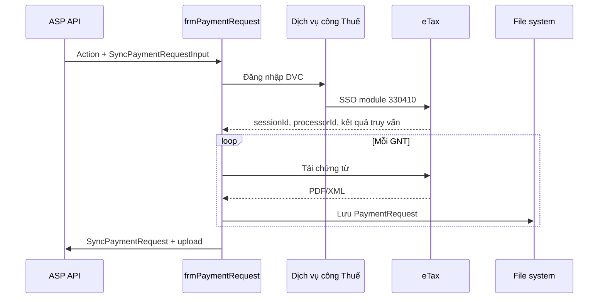

# Luồng đồng bộ giấy nộp tiền từ Dịch vụ công Thuế

## Phạm vi

Khi `CrawlerSource=PublicService`, ứng dụng đăng nhập DVC, dùng SSO sang eTax (`thuedientu.gdt.gov.vn`), tra cứu giấy nộp tiền (GNT), tải chứng từ rồi trả metadata/tệp về ASP. Màn tra cứu và endpoint tải GNT cuối cùng nằm trên eTax.

## Điểm kích hoạt

1. `frmAboutUs.HandleUri` định tuyến `ActionType.SyncPaymentRequest` đến `frmPaymentRequest`.
2. Form đọc `SyncPaymentRequestInput`: `ProfileID`, `AccessToken`, khoảng ngày và từng khách hàng.
3. Mỗi khách hàng gọi `ETaxCrawler.GetPaymentRequest`.
4. Ở nguồn `PublicService`, `ETaxCrawler` gọi `PublicServiceCrawler.GetDocPaymentRequest`, sau đó dùng lại `EtaxClient`, `EtaxSessionId`, `ProcessorID` để parse/tải tệp.

Account type cho SSO được suy ra từ độ dài MST: 14 ký tự là `Household`, còn lại là `Enterprise`.

## Sơ đồ luồng



## 1. Cầu SSO DVC → eTax

Sau khi đăng nhập DVC (cùng chuỗi `homelogin` → CSRF/captcha → `loginLDAP` như luồng tờ khai), `GetDocPaymentRequest` chạy retry tối đa 3 lần:

| Bước | Hành động | Kết quả |
|---|---|---|
| GNT1 | `GET /tthc/dich-vu-khac` | Vào trang dịch vụ khác của DVC. |
| GNT2 | `POST /tthc/sso/redirect-to-service?module=330410`, kèm CSRF | Nhận URL eTax (text hoặc JSON có `url`/`data`). |
| GNT3 | `GET` URL redirect bằng eTax client | Lấy `Location` hoặc redirect script. |
| GNT4 | `GET` URL corp jump kế tiếp | Lấy URL chuyển tiếp tiếp theo. |
| GNT5 | `GET` establish session | Đọc `window.location.href`, trích `dse_sessionId`. |
| GNT6 | Gửi request/session mới, trích hidden input form | Chuẩn bị form SSO. |
| GNT7 | POST form SSO login | Nhận form auto-submit tiếp. |
| GNT8 | Theo form cuối vào trang chính eTax | Hoàn tất phiên eTax. |

Crawler giữ hai `HttpClient`/cookie jar độc lập. eTax client đặt `AllowAutoRedirect=false` để code tự xử lý redirect.

## 2. Tra cứu và trích xuất GNT

1. `Step9_GotoTraCuuGiayNopTienPage` trích `dse_processorId`, `dse_pageId`, và có thể cập nhật `dse_sessionId`.
2. `POST /etaxnnt/Request` với `dse_nextEventName=query`, `type_tax=01`, `pn=1`, `ngay_lap_tu_ngay=FromDate`, `ngay_lap_den_ngay=ToDate` cùng các DSE field.
3. Số trang đọc từ `//*[@id='currAcc']/b[1]`; trang sau lấy bằng `GET /etaxnnt/Request?...&pn={page}`.

Parser đọc `//*[@id='allResultTableBody']/tr`, map cột theo header `//*[@id='data_content_onday']` (fallback theo chỉ số). Metadata gồm mã giao dịch, số GNT, số tiền/loại tiền, trạng thái, số chứng từ, ngày lập/gửi/nộp, ngân hàng và tài khoản.

`HiddenPaymentRequestID` lấy từ callback `downloadGNT(...)` trong `href`/`onclick`; không có link thì `IsHideDownloadLink=true`.

## 3. Tải chứng từ

Với bản ghi có `HiddenPaymentRequestID`, crawler `POST /etaxnnt/Request` với `dse_nextEventName=download`, `ctuId`, khoảng ngày, `isReport=N`, `type=pdf`.

Response rỗng hoặc HTML là lỗi tải. Tên tệp ưu tiên `Content-Disposition` (thay `chungtu` bằng ID); fallback `GNT_{id}.pdf`. Tệp được lưu tại:

```text
{FileUtil.BASE_PATH}/OutputFiles/{profileId}/{customerId}/PaymentRequest/{fileName}
```

Có nhánh dự phòng đọc `MA_NHANG_NOP` để bổ sung `BankCode` nếu response là XML, dù request hiện yêu cầu PDF.

## 4. Trả dữ liệu về ASP

`frmPaymentRequest` đặt bearer token rồi:

1. `POST api/{profileId}/EPaymentRequest/SyncPaymentRequest` với `ActionID`, từng `CustomerID`, `PaymentRequests`, `CrawlErrorType`.
2. Upload multipart đến `api/{profileId}/EPaymentRequest/UploadPaymentRequestFile?type=28&customerID={customerId}` cho từng tệp có `FileName`.

`type=28` là `FileTypeEnum.TaxDeclaration`, được dùng theo code hiện hữu dù endpoint là `EPaymentRequest`.

## Lưu ý vận hành

- Chuỗi SSO, hidden DSE field, table ID/tên cột và callback `downloadGNT` là phụ thuộc bên ngoài.
- Lỗi tải một GNT/upload một tệp được log nhưng không dừng các bản ghi khác.
- Không để cookie, DSE session ID, CSRF, captcha hoặc mật khẩu vào log production; mã hiện tại nên được rà soát che giấu dữ liệu nhạy cảm.

## Mã nguồn tham chiếu

- `MISA.ASP.ClientApp/UI/frmAboutUs.cs`
- `MISA.ASP.ClientApp/UI/TaxDeclaration/frmPaymentRequest.cs`
- `MISA.ASP.ClientApp/BL/PublicServiceCrawler.cs`
- `MISA.ASP.ClientApp/BL/ETaxCrawler.cs`
- `MISA.ASP.ClientApp/Utils/Clients/AspClient.cs`
