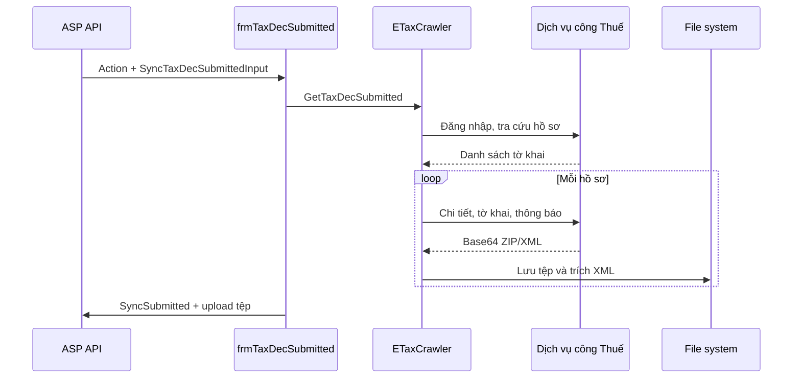

# Luồng đồng bộ tờ khai đã nộp từ Dịch vụ công Thuế

## Phạm vi

Tài liệu mô tả luồng chạy khi `CrawlerSource=PublicService`: đồng bộ **tờ khai đã nộp** từ `dichvucong.gdt.gov.vn`, chuyển metadata về ASP và tải các tệp liên quan. Không gồm tờ khai đã đăng ký hay crawler eTax trực tiếp.

## Điểm kích hoạt và dữ liệu vào

1. Ứng dụng nhận URI, gọi `GET api/ETaxDeclaration/GetActionDetail?actionID={actionID}`.
2. `frmAboutUs.HandleUri` định tuyến `SyncTaxDecSubmitted`/`SyncDvcDecSubmitted` đến `frmTaxDecSubmitted`.
3. Form đọc `SyncTaxDecSubmittedInput`: `ProfileID`, `AccessToken`, `FromDate`, `ToDate` và từng khách hàng (`CustomerID`, `TaxCode`, `Username`, `Password`, `AccountType`).
4. Form gọi `ETaxCrawler.GetTaxDecSubmitted`. Với `CrawlerSource=PublicService`, lớp này chuyển sang `PublicServiceCrawler.GetTaxDecSubmitted`.

Tệp local được lưu theo mẫu `{FileUtil.BASE_PATH}/OutputFiles/{profileId}/{customerId}/{transactionId}/`.

## Sơ đồ luồng

## 1. Đăng nhập DVC

`SignIn` chạy trong `CommonPattern.Retry(..., 5)`:

| Bước | Request | Mục đích |
|---|---|---|
| 1 | `GET /tthc/homelogin` | Khởi tạo cookie DVC. |
| 2 | `GET /tthc/login` | Lấy hidden `_csrf` từ HTML. |
| 3 | `GET /tthc/login/getCaptcha?{timestamp}` | Lấy ảnh captcha; giải qua `MisaCaptchaClient` với source `dichvucong`. |
| 4 | `POST /tthc/loginLDAP` | Gửi tài khoản, mật khẩu Base64 UTF-8, `doiTuong` (`DN`/`CN`) và captcha, kèm `X-XSRF-TOKEN`. |

`status` 200/201 là thành công. Lỗi captcha/thông tin đăng nhập được đổi thành `InvalidCaptchaException`/`InvalidIdentityException`.

## 2. Tra cứu danh sách hồ sơ

1. `GET /tthc/tchs`.
2. Lấy captcha mới qua `GET /tthc/getCaptcha?{timestamp}`.
3. `GET /tthc/ho-so/search` với `tuNgay`, `denNgay`, `scope_tdt1=SELF`, captcha, `page`, `size=10`; request có header HTMX/XHR.
4. Đọc `#totalPage`, rồi tải các trang tiếp theo với cùng bộ lọc.

Mỗi dòng `//table//tbody/tr` (tối thiểu 12 ô) được map thành `TaxDeclarationSubmitted`: mã hồ sơ, mã/tên tờ khai, kỳ thuế, loại tờ khai, số lần bổ sung/nộp, cơ quan thuế, ngày nộp và trạng thái. `Order` có dấu `.` được liên kết với dòng cha để tạo `ParentTransactionID`.

## 3. Xử lý từng hồ sơ

`ProcessTransactionFile` cho mỗi `TransactionID`:

1. `GET /tthc/tchs/files/detail/{maHoSo}?loai=` để lấy trang chi tiết và CSRF mới.
2. `POST /tthc/tchs/downloadhoso` với JSON `{"maHoSo":"..."}`. Phản hồi JSON chứa `content` Base64 và `fileName`.
3. ZIP được giải nén: `*_0.xml` vào `Declarations` (tờ khai chính), tệp còn lại vào `Documents`. Tệp đơn XML cũng vào `Declarations`.
4. XML chính bổ sung mã tờ khai, mã cơ quan thuế và số tiền: `01`/`842` dùng `ct40`, `ct43`; `03` dùng `ctG`; `394` dùng `ct32`; `864` dùng `ct29`; `892` dùng `ctI`.
5. Đọc `#modalThongBao`, rồi `POST /tthc/tchs/downloadthongbao` cho từng `idTbao`; XML thông báo được lưu vào `Notifications` và trích `maTBao`, `soTBao`, `trangThai`, `tenTBao`.

Trang chi tiết/tệp tờ khai retry 3 lần. Thất bại không bỏ bản ghi: đặt `HasDownloadError=true` và `DownloadErrorMsg`.

## 4. Trả dữ liệu về ASP

`frmTaxDecSubmitted` đặt bearer token rồi:

1. `POST api/{profileId}/ETaxDeclaration/SyncSubmitted` với `ActionID`, từng `CustomerID`, danh sách tờ khai và `CrawlErrorType`.
2. Upload multipart tới `api/{profileId}/EtaxDeclaration/UploadTaxDecFile`:
   - Tờ khai chính và tài liệu: `type=TaxDeclaration` (28).
   - Thông báo: `type=TaxNotification` (29).

`transactionID` khi upload ưu tiên `TransactionID`, fallback `HideTransactionID`.

## Lưu ý vận hành

- `CrawlerSource` đang so sánh phân biệt hoa/thường.
- `AccountType.Enterprise` gửi `doiTuong=DN`; các loại khác gửi `CN`.
- Parser phụ thuộc HTML DVC, do đó thay đổi giao diện có thể làm thiếu dữ liệu.
- Không ghi captcha, mật khẩu, cookie, CSRF token hay nội dung tệp vào log production. Mã hiện tại có log một số giá trị nhạy cảm, cần che giấu khi vận hành.

## Mã nguồn tham chiếu

- `MISA.ASP.ClientApp/UI/frmAboutUs.cs`
- `MISA.ASP.ClientApp/UI/TaxDeclaration/frmTaxDecSubmitted.cs`
- `MISA.ASP.ClientApp/BL/ETaxCrawler.cs`
- `MISA.ASP.ClientApp/BL/PublicServiceCrawler.cs`
- `MISA.ASP.ClientApp/Utils/Clients/AspClient.cs`
